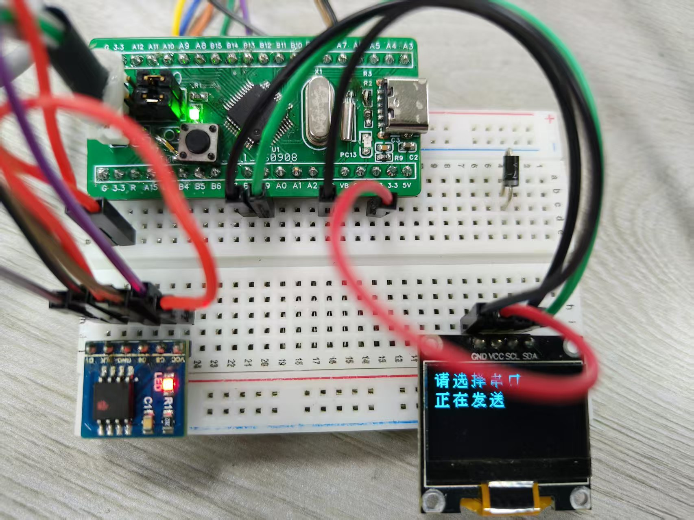

# HZK12 UART -> STM32F103C8T6 -> W25Q64

本示例使用 STM32 标准外设库（SPL）、USART1 和 SPI1 轮询。
PC 应用程序：C# WPF（.NET 10 Windows）。

## 接线
- USB-UART TX -> PA10 (USART1_RX)
- USB-UART RX -> PA9 (USART1_TX)
- GND 共地
- W25Q64 CS -> PB12
- W25Q64 SCK -> PA5 (SPI1_SCK)
- W25Q64 MISO -> PA6 (SPI1_MISO)
- W25Q64 MOSI -> PA7 (SPI1_MOSI)
- W25Q64 VCC -> 3.3 V；WP# 和 HOLD# 拉高（如果引出）

UART：115200 波特率，8 数据位，无校验，1 停止位。
SPI：模式 0，软件 CS。

## 重要说明
1. 此固件为下载的文件保留 W25Q64 中从地址 0x000000 开始的区域。
   它会擦除传入文件所需的所有 4 KB 扇区。除非修改 `FONT_BASE_ADDR`，
   否则不要将该区域用于其他数据。
2. 这是原始二进制文件传输。它不假定特定的 HZK12 布局。
   在将其用于字符查找之前，请验证下载文件的确切格式、字形大小、顺序和编码。
3. W25Q64 容量为 8 MiB = 8,388,608 字节。文件必须能放入。
4. 将 STM32 SPL 源文件添加到你的项目中，包括 stm32f10x_gpio.c、
   stm32f10x_rcc.c、stm32f10x_usart.c、stm32f10x_spi.c、misc.c，
   具体取决于你的 SPL 包以及启动/系统文件的要求。
5. 为你的项目调整 `SystemCoreClock` / 时钟设置。本示例调用 SPL 模板
   通常提供的 `SystemInit()`，并假定 HCLK 为 72 MHz。
6. UART 协议为停止-等待协议，带每包 CRC16 和整文件 CRC32。
   数据包有效载荷为 128 字节。重试由 PC 应用程序处理。
7. 示例固件在下载期间会阻塞。它是一个专用下载器；如果需要同时运行
   其他任务，请将其状态机集成到你的主项目中。

## 协议概要
- 头部：ASCII `HZK1`，文件长度 uint32 小端，文件 CRC32 uint32 小端
- MCU 在擦除目标扇区后回复 `R`
- 数据包：`0xA5`，seq uint16 LE，length uint16 LE（1..128），payload，CRC16-CCITT
  CRC16 覆盖 seq-low、seq-high、len-low、len-high、payload。
- 成功时 MCU 回复 `0x06`、seq-low、seq-high；数据包 CRC/序列失败时回复
  `0x15`、seq-low、seq-high。
- 结束：`0x5A`；如果整文件 CRC32 匹配，MCU 回复 `D`，否则回复 `E`。
